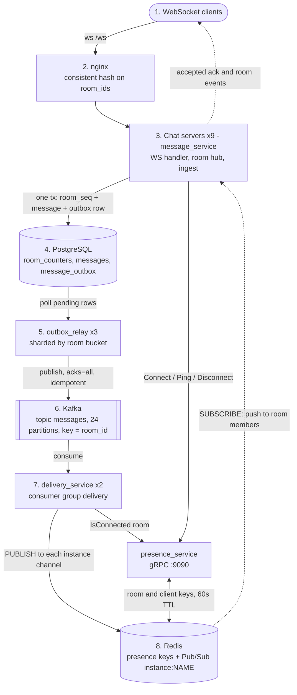

# proper-scale

A horizontally scalable, room-based WebSocket chat backend written in Go. It is the "proper" counterpart to the naive-scale experiment: instead of every server doing everything, the write path, the fan-out path and connection tracking are split into separate services connected by Postgres, Kafka and Redis.

The goal is to study where a chat system bottlenecks as it scales out, so the whole stack runs in Docker Compose with deliberately tiny per-container resource limits and ships with a k6 load-test harness.

## How it works

Clients connect over WebSocket to a chat server and join one or more rooms. A message goes through two stages:

1. **Accept (synchronous).** The chat server stores the message in Postgres, assigns it a per-room sequence number (`room_seq`) and acknowledges it to the sender. The message and an outbox row are written in one transaction.
2. **Deliver (asynchronous).** An outbox relay publishes accepted messages to Kafka, a delivery service looks up which chat servers currently hold connections for that room, and pushes the message to those servers through Redis Pub/Sub. Each server writes it to the sockets of the room members connected to it.

Accepting a message never waits for delivery, and delivery never touches Postgres.

## Architecture



Read it from top to bottom: the solid arrows are the write path (client to Kafka) and the fan-out path (Kafka to Redis). The two dotted arrows at the bottom return to the chat servers and then to the clients, which closes the loop.

## Components

| Service | Path | Responsibility |
|---|---|---|
| **nginx** | `nginx/nginx.conf` | Single entry point on port 80. Proxies `/ws` (with upgrade headers, 1h read timeout) and everything else to the chat servers using `hash $arg_room_ids consistent`, so clients that join the same rooms land on the same server. |
| **Chat server** (`message_service`) | `services/message_service` | WebSocket endpoint `/ws`, in-memory room hub, message validation, idempotent persistence, ping/pong keepalive, Redis subscription for its own `instance:<DIAL>` channel, `/health/live` and `/health/ready` (database ping). Runs its own SQL migrations on startup. |
| **Outbox relay** | `services/outbox_relay` | Polls `message_outbox` for the room buckets it owns, publishes to Kafka in batches, retries with backoff, marks rows published. |
| **Delivery service** | `services/delivery_service` | Kafka consumer group `delivery`. For each event it asks presence which instances host the room and publishes the raw message to each instance's Redis channel. |
| **Presence service** | `services/presence_service` | gRPC `UserService` (`Connect`, `Disconnect`, `Ping`, `IsConnected`) backed by Redis. Tracks which instance each client of a room is on. |
| **wsClient** | `services/wsClient` | Small reference WebSocket client plus end-to-end tests. |
| **Contracts** | `contracts/` | Shared Go modules: `messages` (wire frames, validation, room bucketing), `protos` (presence gRPC definition and generated code), `common` (env helpers). |
| **Load test** | `loadtest/` | k6 script, PowerShell drivers, and recorded results. |

Infrastructure: PostgreSQL 16, Kafka 4.2 (single KRaft node), Redis 7, and an optional Kafka UI under the `tools` compose profile.

## Design decisions

- **Transactional outbox instead of dual writes.** The message row, the room sequence bump and the outbox row commit together, so a message is never acknowledged without also being queued for delivery. The relay marks a row published only after Kafka confirms it, which makes delivery at-least-once.
- **Per-room ordering.** `room_counters` hands out a gapless `room_seq` per room inside the transaction. Kafka messages are keyed by `room_id`, so one room maps to one partition. If a message in a room fails to publish, the relay holds back the later messages of that room in the same batch and retries them in order.
- **Idempotent sends.** `(client_id, client_message_id)` is unique. Retrying a send returns the original `message_id` and `room_seq` instead of creating a duplicate.
- **Sharded relays.** Each room hashes (FNV-1a) into one of 256 buckets. Relay `SHARD_ID` of `SHARD_COUNT` owns buckets `SHARD_ID, SHARD_ID + SHARD_COUNT, ...`, so several relays share the outbox without locking each other.
- **Live fan-out is decoupled from storage.** Delivery only reads Kafka, presence and Redis. Presence entries live in Redis with a 60 second TTL and are refreshed by the server's ping every 54 seconds, so a crashed server's connections expire on their own.
- **Targeted Pub/Sub.** Each chat server subscribes to one channel (`instance:<name>`), and delivery publishes only to the instances that actually host the room, rather than broadcasting to all of them.
- **Backpressure and failure behaviour.** Each socket has a 256-message send buffer. Kafka consumption stops advancing the offset when handling fails, so a failed event is redelivered. Redis Pub/Sub is fire-and-forget; misses are logged.

## Load testing

`loadtest/run-limits.ps1` builds the stack, wipes it, and drives `loadtest/chat_load.js` with k6 (containerized by default, `-NativeK6` to use a local k6). Between steps it resets the stack unless `-NoClean` is passed, and it tears the stack down at the end unless `-KeepUp` is passed.

```powershell
.\loadtest\run-limits.ps1 -Scenario tput -Steps 10,6,4,3,2,1.5,1,0.5 -Rooms 100 -Users 15 -Tag my-run
```

- `-Scenario tput`: each step is the interval in seconds between messages per user. 100 rooms x 15 users is 1,500 sockets.
- `-Scenario conn`: each step is a socket count, with `-ConnUsers` users per room.
- Results go to `loadtest/results/<Tag>/<Scenario>/` as one k6 JSON summary per step plus `summary.md` and `summary.csv`.
- Do not redirect the script's output with `*>` or `2>&1`. Under Windows PowerShell 5.1, Docker's stderr warnings then become terminating errors.

Recorded runs live in `loadtest/results/` and are analysed in [`LOAD_TEST_ANALYSIS.md`](LOAD_TEST_ANALYSIS.md). With 5 servers, room affinity sustains 500 msg/s (7,500 frames/s, p95 1.1 s) and round-robin 375 msg/s. 12 servers sustain 1,000 msg/s (15,000 frames/s) and accept at least 1,283 msg/s. No socket dropped in any step. The limit is the accept path, not delivery. The folders `5x33m-proper` and `5x33_round_robin` are named the wrong way round: per git and the latency data, `5x33m-proper` is the round-robin run.

## Project layout

```
proper-scale/
  docker-compose.yml      full stack: infra, 9 chat servers, 3 relays, 2 delivery services, presence, nginx
  nginx/                  nginx.conf and working notes (worth_metion.md)
  contracts/
    messages/             wire frames, validation, room bucketing
    protos/               presence gRPC proto and generated code
    common/               env helpers
  services/
    message_service/      chat server (ws, hub, ingest, Postgres store, migrations)
    outbox_relay/         outbox poller and Kafka producer
    delivery_service/     Kafka consumer and Redis publisher
    presence_service/     gRPC presence over Redis
    wsClient/             sample client and e2e tests
  loadtest/               k6 script, PowerShell drivers, results
```

## Known limitations

- **Live delivery only.** If nobody in the room is connected, the event is logged as a miss and dropped. There is no offline queue and no history or catch-up endpoint; `room_seq` lets a client detect gaps but nothing serves the missing messages yet.
- **At-least-once, not exactly-once.** A relay crash between the Kafka publish and the database update republishes a message, and a message that reaches a Redis channel with no active subscriber is lost for that instance.
- **No authentication.** `client_id` comes from the query string and any origin is accepted. This is for learning only.
- **Static topology.** The chat servers are listed by hand in `nginx.conf` and `docker-compose.yml`, and the relay `SHARD_COUNT` is hardcoded to match the three relay containers. Scaling means editing both files.
- **Single-node infrastructure.** One Postgres, one Redis, one Kafka broker, one presence service. Presence and the outbox are the shared pieces to scale next.
- **Resource limits are intentionally tight** (chat servers: 33 MB, 0.3 CPU each) so that limits show up under load. They are not production settings.
